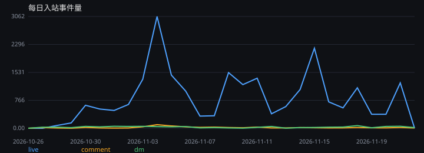
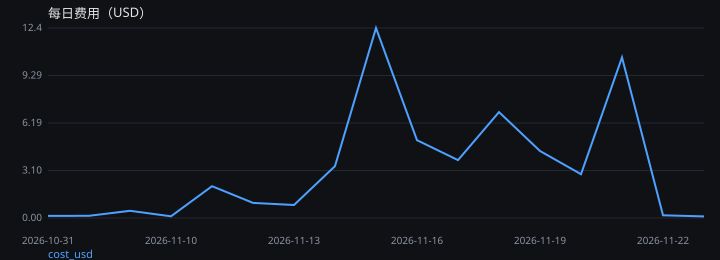
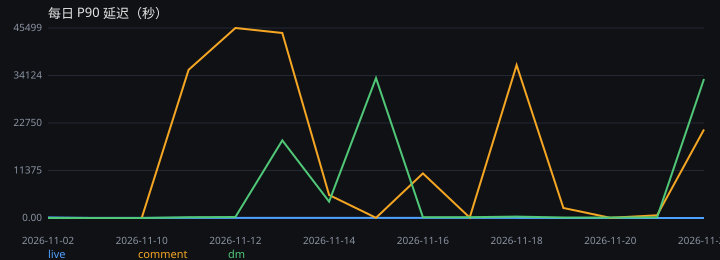

# RaiseMyFish · 30 天线上运行报告

> 数据来源：生产库只读事务（每条查询 `SET TRANSACTION READ ONLY`）。
> 原始 CSV：bench/out/report-20261124224126/csv/。所有数字可由 `bench/sql/` 复现。

## 基线计数

| 表 | 行数 |
|---|---:|
| events | 35942 |
| send_log | 4803 |
| llm_usage | 22564 |
| memory_valid | 1123 |

## 每日事件量

| day | channel | dir | n |
|---|---|---|---|
| 2026-10-26 | comment | in | 2 |
| 2026-10-26 | dm | in | 2 |
| 2026-10-27 | comment | in | 20 |
| 2026-10-27 | dm | in | 29 |
| 2026-10-28 | comment | in | 8 |
| 2026-10-28 | dm | in | 31 |
| 2026-10-28 | live | in | 77 |
| 2026-10-28 | live | out | 155 |
| 2026-10-29 | comment | in | 2 |
| 2026-10-29 | dm | in | 17 |
| 2026-10-29 | live | in | 146 |
| 2026-10-29 | live | out | 293 |
| 2026-10-30 | comment | in | 23 |
| 2026-10-30 | dm | in | 52 |
| 2026-10-30 | live | in | 630 |
| 2026-10-30 | live | out | 1265 |
| 2026-10-31 | comment | in | 9 |
| 2026-10-31 | dm | in | 39 |
| 2026-10-31 | live | in | 527 |
| 2026-10-31 | live | out | 1054 |
| 2026-11-01 | comment | in | 5 |
| 2026-11-01 | dm | in | 55 |
| 2026-11-01 | live | in | 489 |
| 2026-11-01 | live | out | 489 |
| 2026-11-02 | comment | in | 8 |
| 2026-11-02 | dm | in | 50 |
| 2026-11-02 | live | in | 652 |
| 2026-11-02 | live | out | 483 |
| 2026-11-03 | comment | in | 40 |
| 2026-11-03 | dm | in | 53 |
| 2026-11-03 | live | in | 1342 |
| 2026-11-03 | live | out | 134 |
| 2026-11-04 | comment | in | 98 |
| 2026-11-04 | dm | in | 45 |
| 2026-11-04 | dm | out | 2 |
| 2026-11-04 | live | in | 3062 |
| 2026-11-04 | live | out | 423 |
| 2026-11-05 | comment | in | 64 |
| 2026-11-05 | dm | in | 40 |
| 2026-11-05 | live | in | 1457 |
| 2026-11-05 | live | out | 293 |
| 2026-11-06 | comment | in | 39 |
| 2026-11-06 | dm | in | 47 |
| 2026-11-06 | live | in | 1019 |
| 2026-11-06 | live | out | 159 |
| 2026-11-07 | comment | in | 26 |
| 2026-11-07 | dm | in | 12 |
| 2026-11-07 | live | in | 334 |
| 2026-11-07 | live | out | 64 |
| 2026-11-08 | comment | in | 32 |
| 2026-11-08 | dm | in | 19 |
| 2026-11-08 | live | in | 344 |
| 2026-11-08 | live | out | 87 |
| 2026-11-09 | comment | in | 21 |
| 2026-11-09 | dm | in | 10 |
| 2026-11-09 | live | in | 1524 |
| 2026-11-09 | live | out | 328 |
| 2026-11-10 | comment | in | 14 |
| 2026-11-10 | dm | in | 3 |
| 2026-11-10 | live | in | 1195 |
| 2026-11-10 | live | out | 440 |
| 2026-11-11 | comment | in | 32 |
| 2026-11-11 | comment | out | 31 |
| 2026-11-11 | dm | in | 25 |
| 2026-11-11 | dm | out | 12 |
| 2026-11-11 | live | in | 1372 |
| 2026-11-11 | live | out | 833 |
| 2026-11-12 | comment | in | 10 |
| 2026-11-12 | comment | out | 9 |
| 2026-11-12 | dm | in | 50 |
| 2026-11-12 | dm | out | 48 |
| 2026-11-12 | live | in | 397 |
| 2026-11-12 | live | out | 305 |
| 2026-11-13 | comment | in | 9 |
| 2026-11-13 | comment | out | 10 |
| 2026-11-13 | dm | in | 4 |
| 2026-11-13 | dm | out | 4 |
| 2026-11-13 | live | in | 595 |
| 2026-11-13 | live | out | 337 |
| 2026-11-14 | comment | in | 20 |
| 2026-11-14 | comment | out | 19 |
| 2026-11-14 | dm | in | 20 |
| 2026-11-14 | dm | out | 20 |
| 2026-11-14 | live | in | 1062 |
| 2026-11-14 | live | out | 607 |
| 2026-11-15 | comment | in | 14 |
| 2026-11-15 | comment | out | 14 |
| 2026-11-15 | dm | in | 22 |
| 2026-11-15 | dm | out | 22 |
| 2026-11-15 | live | in | 2192 |
| 2026-11-15 | live | out | 1015 |
| 2026-11-16 | comment | in | 10 |
| 2026-11-16 | comment | out | 10 |
| 2026-11-16 | dm | in | 30 |
| 2026-11-16 | dm | out | 30 |
| 2026-11-16 | live | in | 724 |
| 2026-11-16 | live | out | 393 |
| 2026-11-17 | comment | in | 11 |
| 2026-11-17 | comment | out | 11 |
| 2026-11-17 | dm | in | 34 |

_其余 33 行见 CSV。_

## 通道回复与失败

| channel | received | replied | failed |
|---|---|---|---|
| comment | 590 | 175 | 0 |
| dm | 902 | 375 | 0 |
| live | 22822 | 4218 | 9 |

## 每日成本与 token

| day | calls | in_tokens | out_tokens | cost_usd | unknown_calls |
|---|---|---|---|---|---|
| 2026-10-31 | 175 | 894258 | 2184 | 0.135460 | 0 |
| 2026-11-02 | 274 | 806178 | 2185 | 0.143270 | 0 |
| 2026-11-05 | 397 | 3093598 | 13372 | 0.472010 | 6 |
| 2026-11-10 | 1129 | 3329251 | 56775 | 0.114030 | 413 |
| 2026-11-11 | 3845 | 31901068 | 210302 | 2.071830 | 409 |
| 2026-11-12 | 1504 | 16397308 | 111669 | 0.981340 | 122 |
| 2026-11-13 | 1147 | 13678712 | 88291 | 0.847650 | 79 |
| 2026-11-14 | 1917 | 23576705 | 124975 | 3.385909 | 141 |
| 2026-11-15 | 3194 | 40627738 | 239742 | 12.384579 | 150 |
| 2026-11-16 | 1343 | 16638933 | 100192 | 5.071306 | 91 |
| 2026-11-17 | 1081 | 12374483 | 87932 | 3.776772 | 113 |
| 2026-11-18 | 1844 | 22790980 | 119320 | 6.903271 | 204 |
| 2026-11-19 | 1161 | 14360877 | 79685 | 4.367854 | 98 |
| 2026-11-20 | 808 | 9423767 | 54919 | 2.856208 | 88 |
| 2026-11-21 | 2632 | 34406954 | 180442 | 10.470861 | 152 |
| 2026-11-22 | 78 | 588078 | 4022 | 0.175034 | 17 |
| 2026-11-24 | 35 | 338440 | 544 | 0.102186 | 0 |

## 每日延迟分位

| day | channel | n | p50_ms | p90_ms | p99_ms |
|---|---|---|---|---|---|
| 2026-11-02 | live | 264 | 6053 | 143794 | 903383 |
| 2026-11-05 | live | 91 | 3582 | 15205 | 26238 |
| 2026-11-10 | live | 205 | 3079 | 15491 | 779941 |
| 2026-11-11 | comment | 31 | 3269788 | 35499908 | 39387743 |
| 2026-11-11 | dm | 12 | 97895 | 187159 | 199472 |
| 2026-11-11 | live | 652 | 5152 | 27031 | 387484 |
| 2026-11-12 | comment | 10 | 536175 | 45499072 | 47541466 |
| 2026-11-12 | dm | 48 | 90285 | 249032 | 34653745 |
| 2026-11-12 | live | 196 | 6257 | 34911 | 52375 |
| 2026-11-13 | comment | 9 | 12715542 | 44294661 | 61379492 |
| 2026-11-13 | dm | 4 | 1109204 | 18579684 | 24927952 |
| 2026-11-13 | live | 224 | 5623 | 20491 | 49593 |
| 2026-11-14 | comment | 19 | 32849 | 5505936 | 21323060 |
| 2026-11-14 | dm | 20 | 81610 | 3923460 | 16722076 |
| 2026-11-14 | live | 486 | 3946 | 21204 | 46726 |
| 2026-11-15 | comment | 14 | 35732 | 54607 | 31745519 |
| 2026-11-15 | dm | 22 | 94849 | 33511126 | 38268143 |
| 2026-11-15 | live | 737 | 4257 | 16479 | 30411 |
| 2026-11-16 | comment | 10 | 41944 | 10677177 | 21011518 |
| 2026-11-16 | dm | 30 | 91040 | 200069 | 19542471 |
| 2026-11-16 | live | 279 | 3619 | 15643 | 50730 |
| 2026-11-17 | comment | 11 | 35416 | 100969 | 6867454 |
| 2026-11-17 | dm | 33 | 64932 | 191559 | 292081 |
| 2026-11-17 | live | 155 | 4593 | 21416 | 53777 |
| 2026-11-18 | comment | 19 | 14269334 | 36615103 | 52194444 |
| 2026-11-18 | dm | 71 | 94557 | 338464 | 20477895 |
| 2026-11-18 | live | 398 | 9340 | 31170 | 47552 |
| 2026-11-19 | comment | 13 | 56056 | 2396220 | 18484743 |
| 2026-11-19 | dm | 15 | 63857 | 109148 | 118220 |
| 2026-11-19 | live | 125 | 3968 | 9927 | 23229 |
| 2026-11-20 | comment | 11 | 18651 | 46389 | 57287 |
| 2026-11-20 | dm | 47 | 84487 | 108066 | 142183 |
| 2026-11-20 | live | 83 | 3406 | 8682 | 15065 |
| 2026-11-21 | comment | 21 | 43919 | 642418 | 21633079 |
| 2026-11-21 | dm | 53 | 80712 | 161803 | 12130945 |
| 2026-11-21 | live | 323 | 3121 | 11877 | 34944 |
| 2026-11-22 | comment | 7 | 37115 | 21199139 | 23353968 |
| 2026-11-22 | dm | 20 | 72801 | 33279302 | 40808608 |

## 分钟峰值

| peak_per_minute | avg_per_minute | active_minutes |
|---|---|---|
| 24 | 3.48 | 6988 |

## dead 分布

| channel | stage | error_kind | events | errors |
|---|---|---|---|---|
| comment | unknown | unknown | 405 | 0 |
| live | unknown | unknown | 67 | 0 |
| dm | unknown | unknown | 19 | 0 |

## dead 归因覆盖率

| dead_events | with_error_rows | without_error_rows |
|---|---|---|
| 491 | 0 | 491 |

## 失败发送

| channel | error_kind | attempts | events |
|---|---|---|---|
| live | duplicate_window | 6 | 6 |
| live | rate_limit | 2 | 2 |
| live | preflight | 1 | 1 |

## 状态分布

| channel | dir | status | n |
|---|---|---|---|
| comment | in | dead | 405 |
| comment | in | done | 175 |
| comment | in | skipped | 10 |
| comment | out | done | 175 |
| dm | in | dead | 19 |
| dm | in | done | 375 |
| dm | in | skipped | 508 |
| dm | out | done | 377 |
| live | in | dead | 67 |
| live | in | done | 15991 |
| live | in | skipped | 6762 |
| live | out | dead | 19 |
| live | out | done | 11011 |
| live | out | retry | 28 |
| live | out | skipped | 12 |

## 进程重启与降级（日志）

- 日志文件：7 个；fishd 启动（heartbeat_start）：**23 次**
  - 2026-11-18：6 次
  - 2026-11-19：1 次
  - 2026-11-20：2 次
  - 2026-11-21：12 次
  - 2026-11-22：2 次
- ReAct 降级：**142 次**
  - 原因 parse：107 次
  - 原因 timeout：18 次
  - 原因 llm_error：13 次
  - 原因 steps：3 次
  - 原因 empty：1 次
  - 来源 react：96 次
  - 来源 proactive_react：46 次

## 真实缺陷清单

- **comment dead 率 68.6%**（405/590）：止血优先级最高。
- **dm dead 率 2.1%**（19/902）：需要关注。
- **live dead 率 0.3%**（67/22822）：需要关注。
- **dead 归因缺失**：491 条 dead 事件没有 `event_errors` 记录（历史数据早于 0026 迁移），
  当前无法回答「死在哪一环」；新事件必须保证 stage/error_kind 落库。
- **进程重启频繁**：日志覆盖 5 天出现 23 次启动（约 4.6 次/天）；
  日志中没有 watchdog 重启记录（watchdog 未启用），这些是人工/脚本重启，不是自动恢复。
- **ReAct 降级 142 次**，最大原因是 `parse`（107 次）；降级会回落单步，
  回答质量与工具查证能力都会下降，需要按原因分别治理。

## 口径说明

- 延迟口径：`events.at → 首次 send_log.ok`，未改变历史定义。
- 成本：`llm_usage.cost_usd` 求和；`unknown_calls` 为未配置报价的调用数，不能当 0 成本。
- dead：`events.status='dead'` 且近 30 天；`event_errors` 只做原因分类。
- 所有时间按 UTC 切日。
